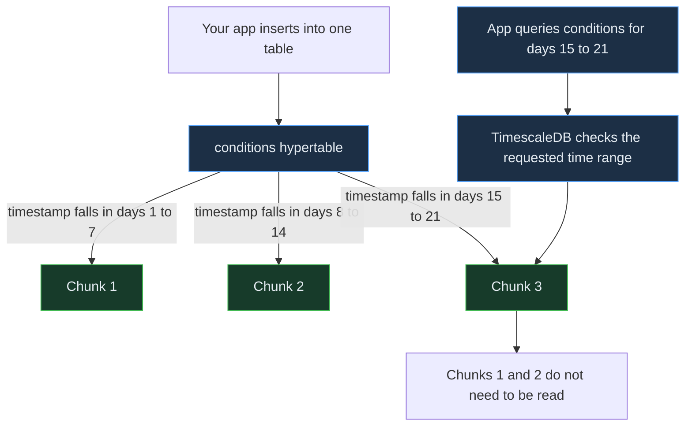

<!-- Generated by `npm run docs` from lesson.mjs. Do not edit by hand. -->

# Module 01 · Hypertables & chunks

Create a hypertable, watch chunks appear, and see the planner skip the ones it does not need.

**Run it:** `npm run lesson 01` · ~8 min

## Objectives

- Create a hypertable with the WITH (tsdb.hypertable) syntax
- Understand what a chunk is and when one is created
- Inspect chunks through timescaledb_information.chunks
- Read an EXPLAIN plan showing chunk exclusion

## 1. Create a hypertable

A hypertable looks and behaves like an ordinary table: you INSERT, SELECT, UPDATE and DELETE with standard SQL. Underneath, rows are automatically partitioned by time into chunks. The only new thing here is the WITH (tsdb.hypertable) clause. The first timestamp column becomes the partitioning column unless you name one explicitly.

_Applications use one table while TimescaleDB routes each row to the chunk covering its timestamp._



```sql
DROP TABLE IF EXISTS conditions;

CREATE TABLE conditions (
  time        TIMESTAMPTZ      NOT NULL,
  location    TEXT             NOT NULL,
  device      TEXT             NOT NULL,
  temperature DOUBLE PRECISION,
  humidity    DOUBLE PRECISION
) WITH (
  tsdb.hypertable,
  tsdb.partition_column = 'time',
  tsdb.chunk_interval = '7 days'
);
```

> **Takeaway** chunk_interval is the width of one chunk. A documented starting criterion is to keep indexes for all chunks currently receiving writes within roughly 25% of available memory, then measure the workload.

## 2. Insert rows and let chunks appear

You never create a chunk yourself. Insert a row whose timestamp falls outside every existing chunk and the database creates the chunk for you. These four rows are spread across four different weeks, so they land in four different chunks.

```sql
INSERT INTO conditions (time, location, device, temperature, humidity)
VALUES
  (now() - INTERVAL '21 days', 'office', 'sensor-1', 21.5, 44.0),
  (now() - INTERVAL '14 days', 'office', 'sensor-1', 22.1, 45.2),
  (now() - INTERVAL '7 days',  'office', 'sensor-1', 22.3, 44.8),
  (now(),                      'office', 'sensor-1', 22.2, 45.1)
RETURNING time, device, temperature;
```

## 3. See the chunks that were created

Each chunk owns a half-open time range [range_start, range_end). A chunk is a real PostgreSQL table underneath, which is why it has its own schema and name.

```sql
SELECT
  chunk_name,
  range_start,
  range_end,
  is_compressed
FROM timescaledb_information.chunks
WHERE hypertable_name = 'conditions'
ORDER BY range_start;
```

> **Takeaway** Four inserts, four weeks apart, produced four chunks. Insert another row into an existing week and no new chunk appears - it simply joins the matching one.

## 4. The same idea at realistic scale

The readings hypertable from the seed holds a month of sensor data with a 1 day chunk interval. Note that each chunk is queried, indexed and compressed independently - that is what keeps operations on huge tables cheap.

```sql
SELECT
  count(*)                                  AS chunks,
  pg_size_pretty(hypertable_size('readings')) AS total_size,
  min(range_start)                          AS oldest,
  max(range_end)                            AS newest
FROM timescaledb_information.chunks
WHERE hypertable_name = 'readings';
```

## 5. Chunk-level detail

chunks_detailed_size breaks a hypertable down chunk by chunk. This is how you spot a chunk interval that is too wide (huge chunks) or too narrow (thousands of tiny chunks).

```sql
SELECT
  chunk_name,
  pg_size_pretty(table_bytes) AS table_size,
  pg_size_pretty(index_bytes) AS index_size,
  pg_size_pretty(total_bytes) AS total
FROM chunks_detailed_size('readings')
ORDER BY chunk_name
LIMIT 5;
```

> **Note** Index bytes are often a large share of an uncompressed chunk. Module 04 shrinks both.

## 6. Chunk exclusion: the payoff

This is the reason time partitioning matters. The query below asks for two hours of data out of a month. Count the scan nodes in your plan: only chunks whose ranges overlap the predicate should be opened. The exact count depends on whether the two-hour window crosses a chunk boundary.

```sql
EXPLAIN (ANALYZE, COSTS OFF, TIMING OFF, SUMMARY OFF)
SELECT avg(temperature)
FROM readings
WHERE time >= now() - INTERVAL '2 hours';
```

> **Takeaway** A time filter turns a whole-table scan into a scan of one or two chunks. Always filter on the partitioning column when you can - it is the single biggest performance lever you have.

## 7. What a query without a time filter costs

Remove the time predicate and every chunk has to be scanned. The plan below is truncated, but note that it lists a separate scan node for every single chunk in the table.

```sql
EXPLAIN (COSTS OFF, SUMMARY OFF)
SELECT avg(temperature) FROM readings;
```

> **Note** Both queries are valid SQL. The difference is purely how much data the planner can rule out.

## 8. Clean up

```sql
DROP TABLE IF EXISTS conditions;
```

## Challenge

Return how many chunks of readings hold data older than 20 days, in a column named old_chunks.

_Hint: Each row in timescaledb_information.chunks has range_end; compare it to now() - INTERVAL._

<details><summary>Solution</summary>

```sql
SELECT count(*) AS old_chunks FROM timescaledb_information.chunks WHERE hypertable_name = 'readings' AND range_end < now() - INTERVAL '20 days';
```

</details>

---

Next: npm run lesson 02  (writing and querying time-series data)
