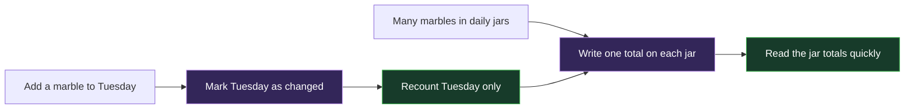
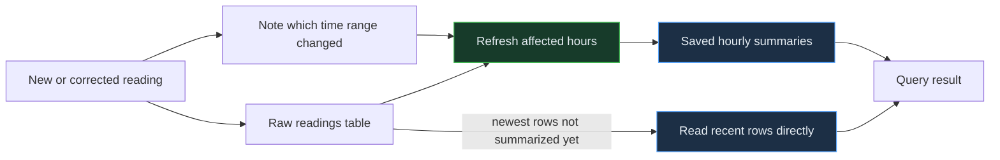

<!-- Generated by `npm run docs` from lesson.mjs. Do not edit by hand. -->

# Module 03 · Continuous aggregates

Pre-compute rollups that refresh incrementally, and measure the speedup yourself.

**Run it:** `npm run lesson 03` · ~10 min

## Objectives

- Create a continuous aggregate over a hypertable
- Refresh it manually and then automatically with a policy
- Understand real-time aggregation and materialized_only
- Stack a daily aggregate on top of an hourly one

## 1. The problem: recomputing the same rollup forever

A dashboard asking for hourly averages over 30 days re-reads every raw row on every refresh. The data for last Tuesday never changes, so almost all of that work is wasted. Time this query - it is the baseline we will beat.

```sql
EXPLAIN (ANALYZE, COSTS OFF, TIMING OFF)

SELECT time_bucket('1 hour', time) AS bucket,
       sensor_id,
       avg(temperature) AS avg_temp
FROM readings
WHERE time >= now() - INTERVAL '30 days'
GROUP BY bucket, sensor_id;
```

## 2. Create the continuous aggregate

A continuous aggregate is a materialized view that TimescaleDB keeps up to date incrementally: it tracks which time ranges changed and re-materializes only those. The definition must contain a time_bucket() on the hypertable's time column. WITH NO DATA means "create it empty and let me decide when to fill it" - always use it on a large table.

> **Everyday analogy — A scoreboard instead of recounting every marble**



_Keep a score for each jar. When one jar changes, recount only that jar—not the whole room._

> **Back to the database** Marbles are raw rows, each jar is a time bucket, the written score is a materialized aggregate, and the note saying “this jar changed” is an invalidation.



_TimescaleDB records which time range changed, refreshes only the affected summary buckets, and can read the newest unsummarized rows directly._

```sql
DROP MATERIALIZED VIEW IF EXISTS readings_daily CASCADE;
DROP MATERIALIZED VIEW IF EXISTS readings_hourly CASCADE;

CREATE MATERIALIZED VIEW readings_hourly
WITH (
  timescaledb.continuous,
  timescaledb.materialized_only = false
) AS
SELECT
  time_bucket('1 hour', time) AS bucket,
  sensor_id,
  avg(temperature)  AS avg_temp,
  sum(temperature)  AS temp_sum,
  count(temperature) AS temp_samples,
  min(temperature)  AS min_temp,
  max(temperature)  AS max_temp,
  avg(humidity)     AS avg_humidity,
  count(*)          AS samples
FROM readings
GROUP BY bucket, sensor_id
WITH NO DATA;
```

> **Takeaway** Modern finalized continuous aggregates support a broad range of PostgreSQL aggregates. For hierarchical rollups, retain composable state such as sum and count when weighting matters.

## 3. Fill it in

refresh_continuous_aggregate materializes complete buckets in a requested range. This bounded refresh deliberately stops one hour ago, preserving a live tail after the watermark. It is invoked with CALL because the API is a PostgreSQL procedure.

```sql
CALL refresh_continuous_aggregate(
  'readings_hourly',
  now() - INTERVAL '30 days',
  now() - INTERVAL '1 hour'
);
```

## 4. Same answer, different cost

The continuous aggregate is itself a hypertable holding one row per bucket per sensor instead of sixty raw rows. Both queries below return the same numbers.

_This step runs a timed comparison in the CLI; see the runner output._

> **Takeaway** The win grows with the time range. Dashboards that scan months of history are exactly the case continuous aggregates exist for.

## 5. Automate the refresh

A policy runs the refresh in the background. start_offset and end_offset define a moving window: here, refresh buckets between 3 days ago and 1 hour ago, every 30 minutes. The end_offset keeps the policy away from data that is still arriving.

```sql
SELECT add_continuous_aggregate_policy('readings_hourly',
  start_offset      => INTERVAL '3 days',
  end_offset        => INTERVAL '1 hour',
  schedule_interval => INTERVAL '30 minutes',
  if_not_exists     => true
) AS job_id;
```

> **Note** start_offset must be larger than the bucket width, and end_offset should be at least one bucket to avoid re-materializing a bucket that is still filling up.

## 6. Real-time aggregation

Since TimescaleDB 2.13, continuous aggregates are materialized-only by default. This lesson opted in with materialized_only = false, so queries combine stored buckets before the watermark with a live aggregate over newer raw rows.

```sql
SELECT view_name, materialized_only, compression_enabled
FROM timescaledb_information.continuous_aggregates
WHERE view_name = 'readings_hourly';
```

## 7. Prove it: insert a row and read it back immediately

This row arrives after the last refresh. Because real-time aggregation is on, it still shows up in the aggregate straight away - watch the sample count for the current hour.

```sql
INSERT INTO readings (time, sensor_id, temperature, humidity, battery, energy_kwh)
VALUES (now(), 1, 99.9, 50, 90, 1000);

SELECT bucket, sensor_id, round(max_temp::numeric, 1) AS max_temp, samples
FROM readings_hourly
WHERE sensor_id = 1 AND bucket >= now() - INTERVAL '1 hour'
ORDER BY bucket DESC;
```

> **Takeaway** max_temp shows 99.9 even though no refresh has run. Set materialized_only = true if you would rather have strictly pre-computed results and lower query cost.

## 8. Stack aggregates on aggregates

A continuous aggregate can be built on another continuous aggregate. The daily rollup below reads the hourly rollup, not the raw table, so it stays cheap no matter how much raw data exists.

```sql
CREATE MATERIALIZED VIEW readings_daily
WITH (timescaledb.continuous) AS
SELECT
  time_bucket('1 day', bucket) AS day,
  sensor_id,
  sum(temp_sum) / NULLIF(sum(temp_samples), 0) AS avg_temp,
  max(max_temp) AS max_temp,
  sum(temp_sum) AS temp_sum,
  sum(temp_samples) AS temp_samples,
  sum(samples)  AS samples
FROM readings_hourly
GROUP BY day, sensor_id
WITH NO DATA;

CALL refresh_continuous_aggregate('readings_daily', NULL, NULL);

SELECT day, sensor_id, round(avg_temp::numeric, 2) AS avg_temp, samples
FROM readings_daily
WHERE sensor_id = 1
ORDER BY day DESC
LIMIT 5;
```

> **Note** Averaging averages is only correct when every bucket has equal weight. This definition carries temperature sum and count upward and divides only after the rollup.

## 9. Tidy the test row

```sql
DELETE FROM readings
WHERE energy_kwh = 1000 AND temperature = 99.9
  AND time >= now() - INTERVAL '1 hour';

CALL refresh_continuous_aggregate('readings_hourly', now() - INTERVAL '2 hours', NULL);
```

## Challenge

Using readings_hourly, return the single hottest bucket recorded for sensor 3: columns bucket and max_temp, one row.

_Hint: ORDER BY max_temp DESC LIMIT 1, filtered to sensor_id = 3._

<details><summary>Solution</summary>

```sql
SELECT bucket, max_temp FROM readings_hourly WHERE sensor_id = 3 ORDER BY max_temp DESC LIMIT 1;
```

</details>

---

Next: npm run lesson 04  (the columnstore)
