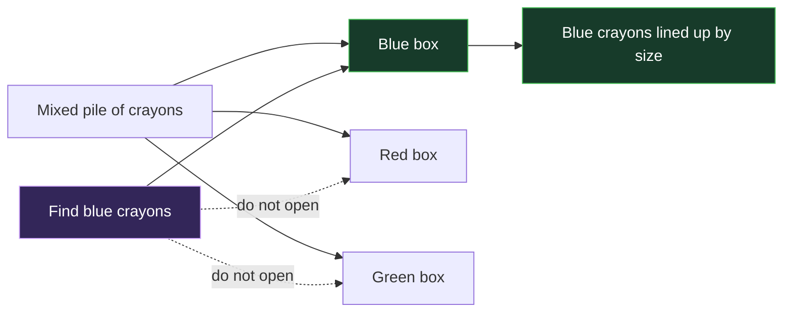
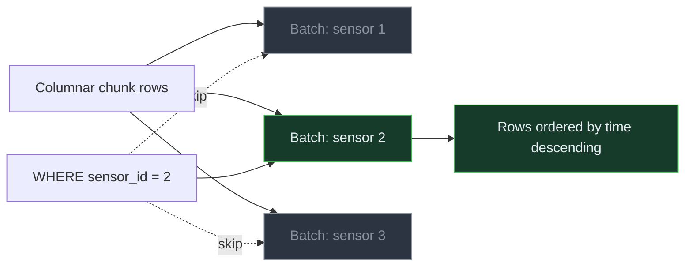

<!-- Generated by `npm run docs` from lesson.mjs. Do not edit by hand. -->

# Module 04 · Hypercore: the columnstore

Convert older chunks to columnar storage and measure the real size and speed difference.

**Run it:** `npm run lesson 04` · ~10 min

## Objectives

- Enable the columnstore and choose segmentby / orderby
- Convert chunks and read the resulting size statistics
- Automate conversion with a columnstore policy
- Know what still works after a chunk is columnar

## 1. Measure the rowstore baseline

Hypercore is a hybrid engine: recent chunks stay row-oriented for fast inserts and single-row lookups, while older chunks are converted to a compressed columnar format for analytics. Nothing is converted yet, so this is the honest "before" measurement - the size of the table and the cost of one analytic query over the chunks we are about to convert.

_This step runs a timed comparison in the CLI; see the runner output._

## 2. Enable the columnstore

Two settings decide how well compression works.

segmentby groups rows that share a value into the same compressed batch. Choose the column you filter by most - here sensor_id - because the engine can then skip whole batches.

orderby controls the order of rows inside a batch. Time descending keeps similar values adjacent, which is what makes the encoding compact and recent-first scans cheap.

> **Everyday analogy — Sort crayons into color boxes, then line them up by size**



_If you want blue crayons, open only the blue box. Inside it, the crayons are already in a useful order._

> **Back to the database** The crayon color is segmentby, each color box is a compressed batch, and crayon size order is orderby. A matching filter can skip unopened boxes.



_Filtering by sensor can skip unrelated batches, while sorting each chosen batch by time keeps nearby readings together._

```sql
ALTER TABLE readings SET (
  timescaledb.enable_columnstore = true,
  timescaledb.segmentby          = 'sensor_id',
  timescaledb.orderby            = 'time DESC'
);
```

> **Note** A table created WITH (tsdb.hypertable) turns the columnstore on by default. The seed for this lab deliberately turns it back off so you can watch the change happen here.

## 3. Convert the older chunks

convert_to_columnstore works on one chunk at a time and is a procedure, so it needs CALL - and CALL does not accept a subquery as an argument. The idiomatic way to convert a set of chunks is a small DO block that loops over the catalog.

```sql
DO $$
DECLARE
  chunk regclass;
BEGIN
  FOR chunk IN
    SELECT format('%I.%I', chunk_schema, chunk_name)::regclass
    FROM timescaledb_information.chunks
    WHERE hypertable_name = 'readings'
      AND NOT is_compressed
      AND range_end < now() - INTERVAL '7 days'
  LOOP
    CALL convert_to_columnstore(chunk);
  END LOOP;
END $$;
```

> **Takeaway** Conversion operates on one target chunk at a time. It still locks and rewrites that chunk, while other chunks can remain row-oriented and available through the same hypertable.

## 4. How much did that save?

hypertable_columnstore_stats reports before and after byte counts for the converted chunks.

_This step runs a timed comparison in the CLI; see the runner output._

> **Takeaway** Ratios depend heavily on segmentby and on how repetitive your data is. Wide, repetitive telemetry compresses far better than random values.

## 5. The same query, now against columnar chunks

This is the identical query from step 1 over the identical rows. The only thing that changed is how those rows are stored. A columnar chunk reads only the columns the query mentions and decodes whole batches at a time, instead of walking row by row past columns nobody asked for.

_This step runs a timed comparison in the CLI; see the runner output._

> **Takeaway** On a small lab dataset the timing win is modest because everything already fits in cache. The size win is immediate and real, and the query win grows sharply once a table no longer fits in memory.

## 6. What the engine stored per chunk

Each converted chunk keeps its own statistics. This is where you look when one chunk compresses much worse than its neighbours.

```sql
SELECT
  chunk_name,
  pg_size_pretty(before_compression_total_bytes) AS before,
  pg_size_pretty(after_compression_total_bytes)  AS after
FROM chunk_columnstore_stats('readings')
ORDER BY chunk_name
LIMIT 5;
```

## 7. Automate it with a policy

In production you do not convert chunks by hand. A columnstore policy converts every chunk once it is older than the given interval. It is a procedure, so it needs CALL.

```sql
CALL add_columnstore_policy('readings', after => INTERVAL '7 days', if_not_exists => true);
```

## 8. The policy is a background job

Every policy in TimescaleDB is a scheduled job. Module 05 covers the job system properly.

```sql
SELECT job_id, proc_name, schedule_interval, config
FROM timescaledb_information.jobs
WHERE hypertable_name = 'readings';
```

## 9. Columnar data is still writable

This is the part people expect to be broken. You can INSERT into, UPDATE and DELETE from a columnar chunk, and query it with ordinary SQL. Backfilling a late-arriving row does not require you to decompress anything by hand.

```sql
INSERT INTO readings (time, sensor_id, temperature, humidity, battery, energy_kwh)
VALUES (now() - INTERVAL '20 days', 1, 17.5, 60, 70, 500)
RETURNING time, sensor_id, temperature;
```

> **Takeaway** Heavy backfill into columnar chunks is still slower than writing to the rowstore, so size the policy interval to cover your normal late-arrival window.

## 10. Tidy the backfilled row

```sql
DELETE FROM readings
WHERE energy_kwh = 500 AND temperature = 17.5
  AND time >= now() - INTERVAL '21 days'
  AND time <  now() - INTERVAL '19 days';
```

## Challenge

Return the compression ratio achieved on readings - before bytes divided by after bytes - as a column named ratio.

_Hint: hypertable_columnstore_stats() returns before_compression_total_bytes and after_compression_total_bytes._

<details><summary>Solution</summary>

```sql
SELECT round(before_compression_total_bytes::numeric / after_compression_total_bytes, 2) AS ratio FROM hypertable_columnstore_stats('readings');
```

</details>

---

Next: npm run lesson 05  (jobs, policies and retention)
