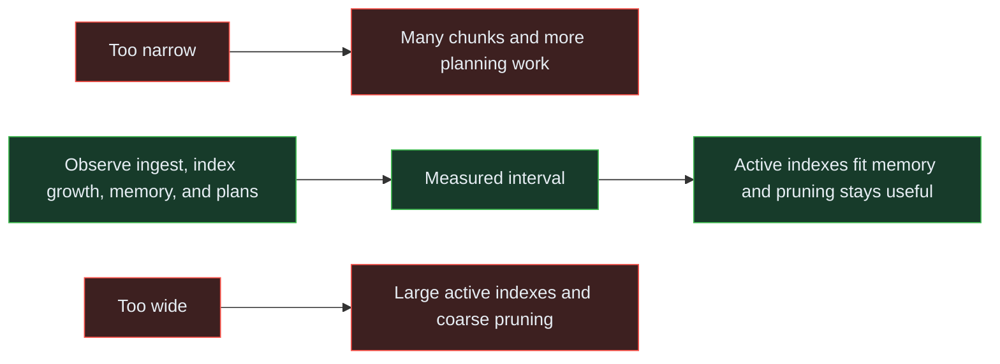

<!-- Generated by `npm run docs` from lesson.mjs. Do not edit by hand. -->

# Module 07 · Performance optimization

Index for your real access pattern, size chunks sensibly, and read plans with confidence.

**Run it:** `npm run lesson 07` · ~10 min

## Objectives

- Read an EXPLAIN plan on a hypertable
- Add an index that matches how you actually filter
- Choose a chunk interval and change it safely
- Use chunk skipping and approximate counts

## 1. What indexes exist by default?

A standard one-dimensional hypertable normally receives a descending index on its partitioning column unless default index creation is disabled. Inspect the actual catalog instead of assuming.

```sql
SELECT indexname, indexdef
FROM pg_indexes
WHERE tablename = 'readings';
```

## 2. A query the default index does not serve

Filtering by device is the most common real-world pattern, and the time index alone cannot satisfy it. Time partitioning narrows the search to a few chunks, then every row in those chunks is checked against sensor_id. Watch for "Filter" and the number of rows removed by it.

_This step runs a timed comparison in the CLI; see the runner output._

## 3. Add an index that matches the access pattern

The column order matters. sensor_id first narrows to one device, then time DESC gives the range scan inside it. The reverse order would leave the database scanning every device in the range.

On a hypertable, CREATE INDEX creates the index on every chunk, including future ones.

```sql
CREATE INDEX IF NOT EXISTS readings_sensor_time_idx
  ON readings (sensor_id, time DESC);
```

## 4. Measure the difference

The same query again, unchanged. Only the available index changed.

_This step runs a timed comparison in the CLI; see the runner output._

> **Takeaway** Indexes are not free: they cost write throughput and disk. Add them for the filters you really run, and check pg_stat_user_indexes later to find ones nobody uses.

## 5. SkipScan: DISTINCT without reading everything

Finding the distinct values of a column normally means scanning every row and de-duplicating. SkipScan uses the index you just created to hop straight from one distinct value to the next, reading a handful of index entries instead of half a million rows.

It applies to SELECT DISTINCT and to "latest row per device" style queries.

_This step runs a timed comparison in the CLI; see the runner output._

> **Takeaway** SkipScan is cost-based. A suitable index is necessary, but statistics, distinct cardinality, NULLs, filters, ordering, and competing plans all affect whether the planner selects it.

## 6. Constraints and schema changes

Hypertables accept ordinary DDL. Adding a column propagates to every chunk, including columnar ones, and CHECK constraints behave normally.

The one hypertable-specific rule is the one module 02 demonstrated: a UNIQUE index must include the partitioning column, because uniqueness is enforced per chunk.

```sql
ALTER TABLE readings ADD COLUMN IF NOT EXISTS firmware TEXT;

ALTER TABLE readings ADD CONSTRAINT humidity_range CHECK (humidity IS NULL OR humidity BETWEEN 0 AND 100);

SELECT column_name, data_type
FROM information_schema.columns
WHERE table_name = 'readings'
ORDER BY ordinal_position;

ALTER TABLE readings DROP CONSTRAINT humidity_range;

ALTER TABLE readings DROP COLUMN firmware;
```

> **Note** Adding a CHECK constraint validates every existing chunk, so it fails if any row violates it - which is exactly what you want. ADD COLUMN with a non-constant DEFAULT rewrites every chunk, so on a large hypertable add the column first and backfill in batches instead.

## 7. Chunk interval: the one sizing decision

A documented starting criterion is that indexes for all chunks currently receiving writes fit in roughly 25% of available memory. Estimate index growth, then measure: overly wide chunks pressure the cache, while overly narrow chunks increase metadata and planning overhead.

_Narrow chunks multiply planning metadata; wide chunks enlarge active indexes and reduce pruning precision._



```sql
SELECT
  h.hypertable_name,
  d.column_name AS partition_column,
  d.time_interval AS chunk_interval,
  (SELECT count(*) FROM timescaledb_information.chunks c
    WHERE c.hypertable_name = h.hypertable_name) AS chunks
FROM timescaledb_information.hypertables h
JOIN timescaledb_information.dimensions d
  ON d.hypertable_name = h.hypertable_name
WHERE d.dimension_number = 1;
```

## 8. Changing the interval

set_chunk_time_interval only affects chunks created from now on. Existing chunks keep their range, which is safe but means the change is gradual.

```sql
SELECT set_chunk_time_interval('readings', INTERVAL '2 days');

SELECT set_chunk_time_interval('readings', INTERVAL '1 day');
```

> **Note** Changed and immediately changed back, so the rest of the lab keeps its 1 day chunks.

## 9. Chunk skipping on a non-time column

In TimescaleDB 2.29, chunk skipping is a tech-preview feature for supported integer-like and timestamp-like columns on columnstore chunks. It is useful when a non-partition column is strongly correlated with time. The seed has no suitable supported column: sensor_id repeats in every chunk, so tracking its range would not exclude useful history.

```sql
SELECT
  round(corr(sensor_id::double precision, extract(epoch FROM time))::numeric, 4)
    AS sensor_time_correlation,
  count(DISTINCT sensor_id) AS sensors
FROM readings;
```

> **Note** Enable tracking before converting chunks: statistics are recorded during conversion, and already converted chunks need reconversion to acquire them. Do not force the feature onto an unsuitable column.

## 10. Counting rows without counting rows

count(*) reads every row. approximate_row_count uses planner statistics instead and answers instantly, which is what you want for a "roughly how much data is here?" panel.

_This step runs a timed comparison in the CLI; see the runner output._

## 11. A short checklist

In order of impact:
1. Filter on the partitioning column so chunks can be excluded.
2. Index the columns you filter by, with the selective column first.
3. Move repeated rollups into continuous aggregates.
4. Convert historical chunks to the columnstore.
5. Only then start tuning chunk intervals and planner settings.

```sql
SELECT
  relname AS index_name,
  idx_scan AS times_used
FROM pg_stat_user_indexes
WHERE relname LIKE 'readings%'
ORDER BY idx_scan DESC
LIMIT 5;
```

> **Takeaway** pg_stat_user_indexes tells you which indexes earn their keep. An index with zero scans after a representative workload is pure overhead.

## Challenge

Return the three largest chunks of readings by total size: columns chunk_name and total_bytes, largest first, breaking ties by chunk_name ascending.

_Hint: chunks_detailed_size() returns one row per chunk. Order by total_bytes DESC, then chunk_name._

<details><summary>Solution</summary>

```sql
SELECT chunk_name, total_bytes FROM chunks_detailed_size('readings') ORDER BY total_bytes DESC, chunk_name LIMIT 3;
```

</details>

---

Next: npm run lesson 08  (capstone)
