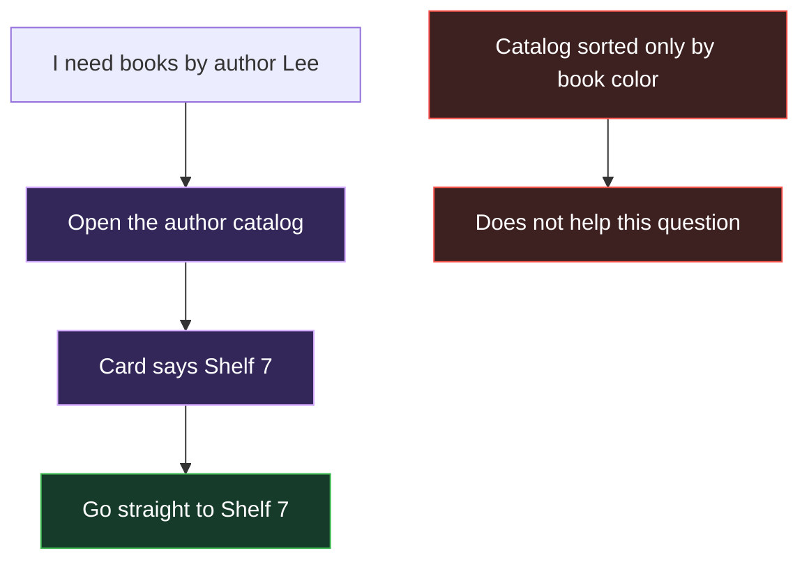
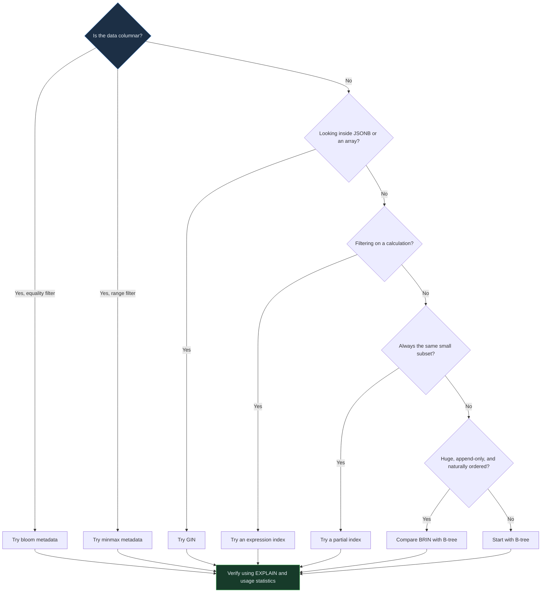

<!-- Generated by `npm run docs` from lesson.mjs. Do not edit by hand. -->

# Module 09 · The index toolbox

Every index type you can put on a hypertable, what each one costs, and when it wins.

**Run it:** `npm run lesson 09` · ~12 min

## Objectives

- Use partial, expression and covering indexes on a hypertable
- Compare BRIN against B-tree on time-ordered data
- Index JSONB with GIN
- Configure the columnstore sparse indexes that TimescaleDB maintains for you

## 1. Indexes on a hypertable are per chunk

One CREATE INDEX on a hypertable creates a physical index on every chunk, and on every future chunk. That is what keeps each index small and lets the planner ignore whole chunks without consulting one giant shared index.

It also means index storage multiplies by the number of chunks, so an unused index is expensive.

```sql
SELECT
  regexp_replace(indexrelname, '^_hyper_\d+_\d+_chunk_', '') AS index_name,
  count(*)                                                    AS physical_copies,
  pg_size_pretty(sum(pg_relation_size(indexrelid)))           AS total_size
FROM pg_stat_user_indexes
WHERE indexrelname ~ 'readings'
GROUP BY 1
ORDER BY sum(pg_relation_size(indexrelid)) DESC;
```

> **Takeaway** The default time index alone already exists once per chunk. Add further indexes deliberately.

## 2. Partial index: index only the rows you search for

A partial index carries a WHERE clause and only stores matching rows. Alerting queries are the classic case: you only ever look for the unhealthy minority, so indexing the healthy majority is wasted space and write cost.

```sql
CREATE INDEX IF NOT EXISTS readings_low_battery_idx
  ON readings (time DESC)
  WHERE battery < 70;

EXPLAIN (ANALYZE, COSTS OFF, TIMING OFF, SUMMARY OFF)
SELECT sensor_id, time, battery
FROM readings
WHERE battery < 70
  AND time >= now() - INTERVAL '2 days'
ORDER BY time DESC
LIMIT 10;
```

> **Takeaway** The planner only uses a partial index when the query predicate implies the index predicate. Searching battery < 90 would not use an index built for battery < 70.

## 3. Expression index: index the computed value

If you filter or group by an expression, index the expression itself. Without it the database has to compute that expression for every candidate row before it can compare anything.

```sql
CREATE INDEX IF NOT EXISTS readings_tempint_idx
  ON readings ((temperature::int));

EXPLAIN (COSTS OFF, SUMMARY OFF)
SELECT count(*) FROM readings
WHERE temperature::int = 20
  AND time >= now() - INTERVAL '1 day';
```

> **Note** The query must contain an expression the planner can match to the indexed expression. PostgreSQL normalizes some equivalent forms, but temperature::int and round(temperature) are different.

## 4. Covering index: answer from the index alone

INCLUDE adds payload columns to a B-tree without making them part of the key. If every column a query needs is present, PostgreSQL can use an Index Only Scan. It may still visit heap pages whose visibility-map bits are not set, so inspect Heap Fetches rather than assuming zero.

Look for "Index Only Scan" and "Heap Fetches" in the plan.

```sql
CREATE INDEX IF NOT EXISTS readings_cover_idx
  ON readings (sensor_id, time DESC) INCLUDE (temperature);

EXPLAIN (ANALYZE, COSTS OFF, TIMING OFF, SUMMARY OFF)
SELECT sensor_id, time, temperature
FROM readings
WHERE sensor_id = 3
  AND time >= now() - INTERVAL '6 hours'
ORDER BY time DESC;
```

> **Takeaway** Covering indexes trade disk for reads. They pay off on narrow, very hot queries - not as a default habit.

## 5. BRIN: a tiny index for naturally ordered data

A BRIN index stores only the minimum and maximum value per block range, so it is orders of magnitude smaller than a B-tree. It works when the column correlates with physical order, which is exactly what a time column in an append-only table does.

Compare the two sizes below.

```sql
CREATE INDEX IF NOT EXISTS readings_brin_idx
  ON readings USING brin (time);

SELECT
  regexp_replace(indexrelname, '^_hyper_\d+_\d+_chunk_', '') AS index_name,
  pg_size_pretty(sum(pg_relation_size(indexrelid)))           AS total_size
FROM pg_stat_user_indexes
WHERE indexrelname ~ 'readings_brin_idx|readings_time_idx'
GROUP BY 1
ORDER BY 1;
```

> **Takeaway** BRIN is a small fraction of the equivalent B-tree. The trade is precision: BRIN narrows the search to block ranges, and the rows inside them still have to be rechecked.

## 6. GIN: indexing inside JSONB

Semi-structured payloads need GIN, which indexes the contents of a value rather than the value itself. It powers the containment operator @> and makes tag or attribute lookups viable.

```sql
DROP TABLE IF EXISTS events_json CASCADE;

CREATE TABLE events_json (
  time    TIMESTAMPTZ NOT NULL,
  payload JSONB
) WITH (tsdb.hypertable, tsdb.partition_column = 'time');

INSERT INTO events_json
SELECT now() - make_interval(mins => i),
       jsonb_build_object('level', i % 5, 'tag', 't' || (i % 9), 'host', 'h' || (i % 30))
FROM generate_series(1, 20000) AS i;

CREATE INDEX events_json_gin_idx ON events_json USING gin (payload);

EXPLAIN (ANALYZE, COSTS OFF, TIMING OFF, SUMMARY OFF)
SELECT count(*) FROM events_json WHERE payload @> '{"tag": "t3"}';
```

> **Note** Use jsonb_path_ops - CREATE INDEX ... USING gin (payload jsonb_path_ops) - for a smaller, faster index for @>, @?, and @@. It does not support the key-existence operators ?, ?|, and ?&.

## 7. Hash: equality and nothing else

A hash index supports = only: no ranges, no ordering, no sorting. It can be smaller than a B-tree for wide keys, but a B-tree serves equality too, so hash is rarely the right answer.

```sql
CREATE INDEX IF NOT EXISTS events_json_hash_idx
  ON events_json USING hash ((payload ->> 'host'));
```

> **Note** Included for completeness. Reach for a B-tree first: one structure handles equality, ranges and ORDER BY.

## 8. Sparse indexes: the ones you configure, not create

Columnar chunks work differently. Rows live inside compressed batches, so a row-oriented index would be useless. Instead TimescaleDB keeps small per-batch summaries called sparse indexes and uses them to discard entire batches before decompressing anything.

Configurable minmax records a range per batch, while bloom stores a probabilistic filter for equality lookups. TimescaleDB 2.28+ also creates automatic firstlast metadata for orderby columns. You configure bloom and minmax as table options rather than with CREATE INDEX.

```sql
DROP TABLE IF EXISTS spans CASCADE;

CREATE TABLE spans (
  time       TIMESTAMPTZ NOT NULL,
  tenant_id  INT         NOT NULL,
  trace_id   TEXT        NOT NULL,
  latency_ms DOUBLE PRECISION
) WITH (tsdb.hypertable, tsdb.partition_column = 'time', tsdb.chunk_interval = '1 day');

INSERT INTO spans
SELECT ts, 1 + (i % 4), md5(i::text), 10 + (i % 500)
FROM generate_series(now() - INTERVAL '4 days', now(), INTERVAL '2 seconds')
     WITH ORDINALITY AS g(ts, i);

ALTER TABLE spans SET (
  timescaledb.enable_columnstore = true,
  timescaledb.segmentby          = 'tenant_id',
  timescaledb.orderby            = 'time DESC',
  timescaledb.sparse_index       = 'bloom(trace_id), minmax(latency_ms)'
);

DO $$
DECLARE chunk regclass;
BEGIN
  FOR chunk IN
    SELECT format('%I.%I', chunk_schema, chunk_name)::regclass
    FROM timescaledb_information.chunks
    WHERE hypertable_name = 'spans' AND NOT is_compressed
  LOOP
    CALL convert_to_columnstore(chunk);
  END LOOP;
END $$;
```

> **Note** A segmentby column cannot have a sparse index: rows are already grouped by it, so there is nothing left to summarise.

## 9. Watch the bloom filter skip batches

Now find a single trace among hundreds of thousands of rows. In the plan, the filter bloom1_contains_any_hashes runs against compressed batches - the rows it removes at that level are entire batches thrown away without ever being decompressed.

_This step runs a timed comparison in the CLI; see the runner output._

> **Takeaway** Sparse indexes trade metadata and build work for batch pruning; bloom filters can produce false positives. Verify their value with EXPLAIN batch-filter counters instead of assuming.

## 10. Choosing an index

A rough decision order:
- Range or equality on rowstore data → B-tree, most selective column first
- Only ever a small subset of rows → partial index
- Filtering on a computed value → expression index
- One very hot, narrow query → covering index with INCLUDE
- Huge, append-only, time-correlated → BRIN
- Inside JSONB or arrays → GIN
- Equality on columnar data → bloom sparse index
- Ranges on columnar data → minmax sparse index

Then confirm with pg_stat_user_indexes and delete whatever nothing uses.

> **Everyday analogy — Use a library catalog instead of checking every shelf**



_A catalog helps only when it is organized around the question you ask._

> **Back to the database** Books are table rows, shelves are table pages, and catalog cards are index entries. Different indexes are different catalog arrangements, so the query shape decides which catalog may help.



_Ask one question at a time. The result is a candidate, not a guarantee: always verify it with the real query plan._

```sql
SELECT
  regexp_replace(indexrelname, '^_hyper_\d+_\d+_chunk_', '') AS index_name,
  sum(idx_scan)                                     AS scans,
  pg_size_pretty(sum(pg_relation_size(indexrelid))) AS size
FROM pg_stat_user_indexes
WHERE indexrelname ~ 'readings'
GROUP BY 1
ORDER BY sum(idx_scan) DESC;
```

> **Takeaway** Zero scans after a representative observation window is a reason to investigate, not automatic permission to drop: statistics reset, replicas and rare jobs may use it, and unique indexes enforce constraints.

## 11. Clean up

Remove what this module created so the lab returns to its seeded state.

```sql
DROP INDEX IF EXISTS readings_low_battery_idx;

DROP INDEX IF EXISTS readings_tempint_idx;

DROP INDEX IF EXISTS readings_cover_idx;

DROP INDEX IF EXISTS readings_brin_idx;

DROP TABLE IF EXISTS events_json CASCADE;

DROP TABLE IF EXISTS spans CASCADE;
```

## Challenge

Return the total on-disk size in bytes of every physical copy of the default time index on readings (its name ends in readings_time_idx), in a column named bytes.

_Hint: pg_stat_user_indexes has indexrelid and indexrelname; sum pg_relation_size(indexrelid)._

<details><summary>Solution</summary>

```sql
SELECT sum(pg_relation_size(indexrelid))::bigint AS bytes FROM pg_stat_user_indexes WHERE indexrelname LIKE '%readings_time_idx';
```

</details>

---

Next: npm run lesson 10  (roaring bitmaps)
