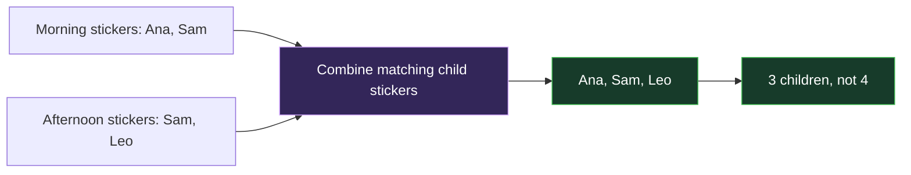
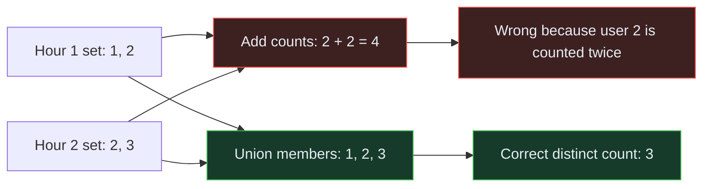
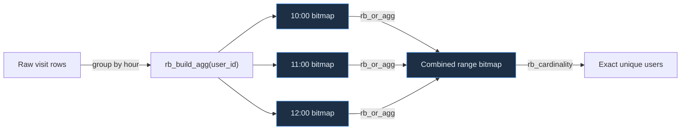
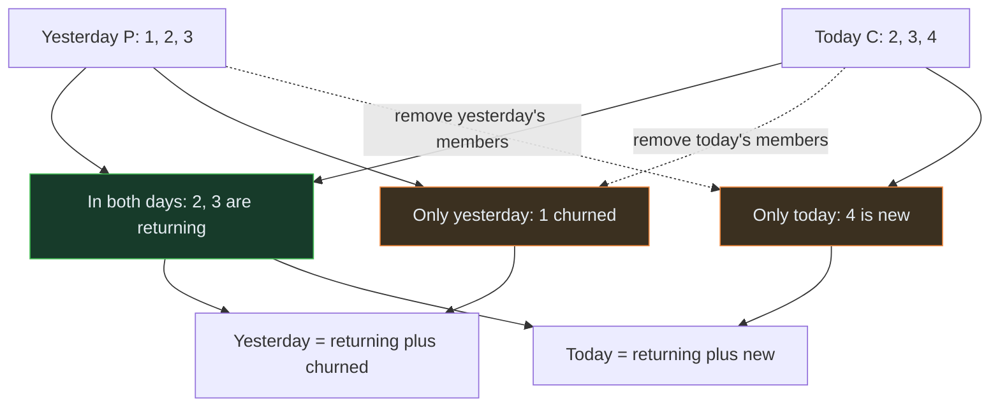

<!-- Generated by `npm run docs` from lesson.mjs. Do not edit by hand. -->

# Module 10 · Roaring bitmaps

Store integer id sets as compressed bitmaps, then answer exact distinct, overlap, and churn questions from rollups.

**Run it:** `npm run lesson 10` · ~12 min

## Objectives

- Build roaring bitmaps and run set operations on them
- See how much smaller a bitmap is than the equivalent id list
- Materialise per-bucket id sets in a continuous aggregate
- Answer unique, retention and churn questions without touching raw rows

## 1. The problem: distinct counts do not roll up

Suppose hour 1 contains users {1, 2} and hour 2 contains {2, 3}. Adding the two hourly distinct counts gives 4, but the day contains only 3 distinct users because user 2 appears twice. A count forgets who was counted, so distinct counts cannot be added safely.

A roaring bitmap keeps the integer members of the set in compressed form. That lets PostgreSQL combine the sets first and count them afterward.

> **Everyday analogy — Combine sticker books before counting children**



_Two class lists both contain Sam. Counting each list separately counts Sam twice._

> **Back to the database** Each sticker book is one time bucket, each numbered child is a member ID, and combining unique stickers is a bitmap union. Count only after duplicate stickers merge.



_User 2 occurs in both hours, so adding hourly counts double-counts that user._

```sql
SELECT
  2 + 2 AS wrong_sum_of_hourly_counts,
  cardinality(ARRAY[1, 2, 3]) AS correct_daily_count;
```

> **Takeaway** Combine membership first, then count. A bitmap is useful because it preserves membership.

## 2. Enable the extension

Roaring bitmaps come from the third-party pg_roaringbitmap PostgreSQL extension, not TimescaleDB Toolkit. Available means the server has the extension files; installed means this database can already use its functions. Check both before relying on it.

```sql
SELECT name, default_version, installed_version
FROM pg_available_extensions
WHERE name = 'roaringbitmap';

CREATE EXTENSION IF NOT EXISTS roaringbitmap;

SELECT extname, extversion FROM pg_extension WHERE extname = 'roaringbitmap';
```

> **Note** If the first query returns no row, this server image does not provide the extension. Do not continue by guessing function names; choose a supported deployment or another set representation.

## 3. Build one and take it apart

Read A AND B as “in both sets,” A OR B as “in either set,” and A ANDNOT B as “in A but not B.” Before running the query, predict each array on paper. rb_build converts an integer array into a bitmap, rb_to_array makes the result visible again, and rb_cardinality counts its members.

```sql
SELECT
  rb_cardinality(rb_build(ARRAY[1,2,3,100,1000]))                       AS members,
  rb_to_array(rb_and(rb_build(ARRAY[1,2,3]), rb_build(ARRAY[2,3,4])))   AS intersection,
  rb_to_array(rb_or(rb_build(ARRAY[1,2]), rb_build(ARRAY[3,4])))        AS union_of,
  rb_to_array(rb_andnot(rb_build(ARRAY[1,2,3]), rb_build(ARRAY[2])))    AS difference;
```

> **Takeaway** These are exact set operations, not estimates. Unlike HyperLogLog, a roaring bitmap can tell you both how many members there are and exactly which ones.

## 4. Why it is worth doing

Compression depends on the values, not just their count. This compares the same 100,000 dense integers as a PostgreSQL array and a bitmap. Treat the measured ratio as a result for this dataset, not a promise for every workload.

_This step runs a timed comparison in the CLI; see the runner output._

> **Note** Sparse, widely-scattered ids compress less well than dense ranges. Bitmaps suit dense integer ids such as user or device keys, not random UUIDs.

## 5. A dataset with real overlap

Seven days of page visits. The active user population shifts from day to day - some users are present on both of any two days, some are not - which is what makes the retention questions later meaningful. You do not need to understand the data-generator arithmetic. Its contract is the important part: 4,000 active users per full day, with 3,000 returning and 1,000 changing.

```sql
DROP MATERIALIZED VIEW IF EXISTS visits_hourly CASCADE;

DROP TABLE IF EXISTS visits CASCADE;

CREATE TABLE visits (
  time    TIMESTAMPTZ NOT NULL,
  user_id INT         NOT NULL,
  page    TEXT
) WITH (tsdb.hypertable, tsdb.partition_column = 'time', tsdb.chunk_interval = '1 day');

INSERT INTO visits (time, user_id, page)
SELECT
  ts,
  1 + ((i * 7919) % 4000)
    + CASE WHEN (extract(doy FROM ts)::int % 2) = 0 THEN 0 ELSE 1000 END,
  'p' || (i % 20)
FROM generate_series(now() - INTERVAL '7 days', now(), INTERVAL '5 seconds')
     WITH ORDINALITY AS g(ts, i);

SELECT count(*) AS visits, count(DISTINCT user_id) AS unique_users FROM visits;
```

## 6. Materialise the id set per hour

A continuous aggregate is a stored time-based rollup maintained by TimescaleDB. rb_build_agg collects every user_id in an hour into one bitmap. WITH NO DATA creates the rollup definition without filling it; refresh_continuous_aggregate then materialises the existing hours.

This is the key move: a distinct count cannot be combined later, but a set can.



_Each hour stores membership once; larger time ranges union those hourly sets before counting._

```sql
CREATE MATERIALIZED VIEW visits_hourly
WITH (timescaledb.continuous) AS
SELECT
  time_bucket('1 hour', time) AS bucket,
  rb_build_agg(user_id)       AS users,
  count(*)                    AS hits
FROM visits
GROUP BY bucket
WITH NO DATA;

CALL refresh_continuous_aggregate('visits_hourly', NULL, NULL);

SELECT bucket, rb_cardinality(users) AS unique_users, hits
FROM visits_hourly
ORDER BY bucket DESC
LIMIT 5;
```

> **Takeaway** The rollup stores a set per hour, not a number. Everything from here on reads only this rollup.

## 7. Exact unique users over any range

Union the hourly bitmaps and count the result. The answer is exact - identical to running count(DISTINCT) over the raw table - but it reads a handful of rollup rows instead of every visit.

_This step runs a timed comparison in the CLI; see the runner output._

> **Takeaway** This is the payoff: exact distinct counts that roll up. Keep the rollup and you can drop the raw rows only after ensuring no future aggregate refresh window overlaps the retained bitmap history.

## 8. Unique users per day, from the hourly sets

Because sets combine, a daily figure is just a union of that day's hourly bitmaps. No raw data is touched, and the numbers are exact rather than the sum of hourly counts (which would double-count anyone active in two hours). Before running it, predict which will be larger: unique_users or naive_sum_of_hourly, and explain why.

```sql
SELECT
  time_bucket('1 day', bucket)               AS day,
  rb_cardinality(rb_or_agg(users))           AS unique_users,
  sum(rb_cardinality(users))                 AS naive_sum_of_hourly,
  sum(hits)                                  AS visits
FROM visits_hourly
GROUP BY day
ORDER BY day;
```

> **Takeaway** Compare unique_users against naive_sum_of_hourly. The naive column is what you get by summing per-hour distinct counts, and it is badly wrong - that error is exactly what bitmaps remove.

## 9. Retention and churn are set operations

Call yesterday P (previous) and today C (current). Translate the business words before reading the SQL:
- returning = P AND C
- churned = P ANDNOT C
- new = C ANDNOT P

lag(users) places yesterday's bitmap in prev beside today's bitmap. Predict 3,000 returning, 1,000 churned, and 1,000 new users for each pair of full days.



_The operand order determines whether a member is classified as churned or new._

```sql
WITH daily AS (
  SELECT time_bucket('1 day', bucket) AS day, rb_or_agg(users) AS users
  FROM visits_hourly
  GROUP BY day
), pairs AS (
  SELECT day, users, lag(users) OVER (ORDER BY day) AS prev
  FROM daily
)
SELECT
  day,
  rb_cardinality(users)                  AS active,
  rb_cardinality(rb_and(users, prev))    AS returning,
  rb_cardinality(rb_andnot(prev, users)) AS churned,
  rb_cardinality(rb_andnot(users, prev)) AS new_users
FROM pairs
WHERE prev IS NOT NULL
ORDER BY day;
```

> **Takeaway** None of this is possible from stored counts. It only works because the rollup kept the membership, not just the size.

> **Note** The numbers are identical every day because the sample data alternates between two overlapping user pools by design - 3000 shared, 1000 unique to each. Real data is messier; the arithmetic is the same.

## 10. Clean up

Drop what this module created. The extension is left installed - it costs nothing idle.

```sql
DROP MATERIALIZED VIEW IF EXISTS visits_hourly CASCADE;

DROP TABLE IF EXISTS visits CASCADE;
```

## Challenge

Build one bitmap for sensor_ids that reported in the last 24 hours. Return its exact member count as sensors and its sorted members as sensor_ids. Use a CTE so the bitmap is built only once.

_Hint: First build one bitmap in a CTE. Then apply the two accessor functions used in step 3._

<details><summary>Solution</summary>

```sql
WITH active AS (
  SELECT rb_build_agg(sensor_id) AS ids
  FROM readings
  WHERE time >= now() - INTERVAL '24 hours'
)
SELECT rb_cardinality(ids) AS sensors, rb_to_array(ids) AS sensor_ids
FROM active;
```

</details>

---

Next: npm run lesson 11  (continuous aggregates in production)
